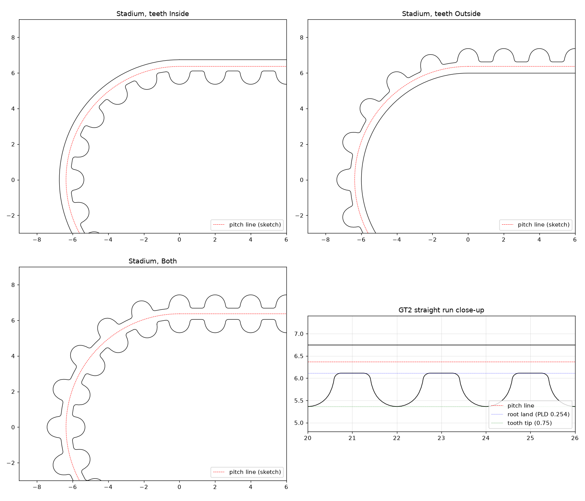

# FreeCAD Toothed Belt

Parametric timing belts for FreeCAD. Draw the belt's **pitch line** in a sketch
(around pulleys, idlers, any closed loop or open run) and the workbench builds
the toothed belt solid along it. Change the sketch and the belt follows.

Supported profiles: **GT2, GT1.5, HTD 5M, HTD 8M** — single-sided (teeth inside
or outside) or double-sided.



This is a FreeCAD port of TurtleCrawler's
[Fusion-ToothedBeltGenerator](https://github.com/TurtleCrawler/Fusion-ToothedBeltGenerator)
(MIT). The profile table and the curvature-aware root-fillet solver come from
that add-in. The FreeCAD side was rewritten around a normal parametric object,
so it needs none of the original's rebuild watchers.

## Status

**0.1.0, early.** Tested headless on FreeCAD 26.3 (conda-forge, Linux). It has
not yet been tried in an interactive FreeCAD session on Windows or macOS, and
the tooth geometry has not yet been checked against a real belt (see
*Accuracy*).

## Install

Until it is listed in the Addon Manager, clone (or download and unzip) into
your FreeCAD `Mod` folder and restart FreeCAD. The folder location differs
between FreeCAD versions; to find yours, type this in FreeCAD's Python console:

```python
import os; print(os.path.join(App.getUserAppDataDir(), "Mod"))
```

```
cd <that folder>
git clone https://github.com/cdracars/freecad-toothed-belt.git
```

The **Toothed Belt** workbench then appears in the workbench list.

## Use

1. Sketch the belt path **on the pitch line** — for a pulley that is its pitch
   circle, diameter `teeth × pitch / π` (20T GT2 → `20 × 2 / π` ≈ 12.732 mm).
2. Select the sketch and click **Toothed belt**.
3. Adjust the belt's properties:

| Property | Meaning |
|---|---|
| `Path` | The sketch (or any planar wire) used as the pitch line |
| `Profile` | GT2, GT1.5, HTD 5M, HTD 8M |
| `TeethSide` | `Inside` / `Outside` of a closed loop; on an open path `Inside` is the left of the path direction. `Both` = double-sided |
| `Width` | Belt width (accepts expressions / spreadsheet links) |
| `Symmetric` | Extrude half the width each side of the sketch plane |
| `RootFillets` | Root fillets, adjusted to the local bend of the path |
| `WireIndex` | Which wire to use if the sketch has several |

Read-only results: `ToothCount`, `PathLength`, and `PitchError`.

**PitchError** matters: a closed loop has to hold a whole number of teeth. If
your sketched loop is, say, 204.37 mm, the belt is built with 102 teeth spread
slightly to fit, `PitchError` shows +0.371 mm, and the report view warns you
that the nearest real belt is 102T = 204 mm. Adjust the centre distance until
the error is ~0 to model a belt you can actually buy.

### Laying out idlers and backside bearings

| Profile | Pitch | Tooth height | Backing | PLD | Back face to pitch line (`backing − PLD`) |
|---|---|---|---|---|---|
| GT1.5 | 1.50 | 0.56 | 0.44 | 0.230 | 0.210 |
| GT2 | 2.00 | 0.75 | 0.63 | 0.254 | 0.376 |
| HTD 5M | 5.00 | 2.06 | 1.74 | 0.5715 | 1.1685 |
| HTD 8M | 8.00 | 3.38 | 2.62 | 0.686 | 1.934 |

All values in mm.

- **Smooth idler on the back of the belt:** pitch-line radius = idler radius + (backing − PLD).
- **Smooth idler on the tooth side:** pitch-line radius = idler radius + PLD + tooth height.

## Accuracy

The tooth outline (tip, flank and root radii) is the original add-in's
approximation. It has **not** been checked against manufacturer drawings or a
measured belt yet. The pitch, PLD, tooth height and backing values match the
published nominal sizes. That's good for fit checks and assembly models. For
printing belts or pulleys that must mesh, verify against a real belt first.

## Known limitations

- Build time grows with tooth count, at about 4 s for an 80-tooth belt.
- A bend tighter than the belt allows (such as an inside offset larger than the
  bend radius) fails with an error in the report view instead of a belt.
- The belt is a plain Part object. In a PartDesign Body, bring it in with a
  Binder or use it outside the Body.

## Development

The geometry splits into three layers:

```
freecad/toothedbelt/
  profiles.py   profile data
  solver.py     pure math: tooth layout, flank geometry, root-fillet solver (no FreeCAD)
  geometry.py   Part geometry: path walking, backing band, tooth faces, extrusion
  feature.py    parametric FeaturePython object + view provider
  commands.py   GUI command
  init_gui.py   workbench registration
```

Tests:

```
# pure-math tests: any Python with pytest
python -m pytest tests/test_solver.py

# full suite against FreeCAD's Python (conda-forge example)
micromamba create -p ./fcenv -c conda-forge freecad pytest
FREECAD_LIB=./fcenv/lib ./fcenv/bin/python -m pytest
```

## License

MIT. See [LICENSE](LICENSE). Includes work from
[TurtleCrawler/Fusion-ToothedBeltGenerator](https://github.com/TurtleCrawler/Fusion-ToothedBeltGenerator).
